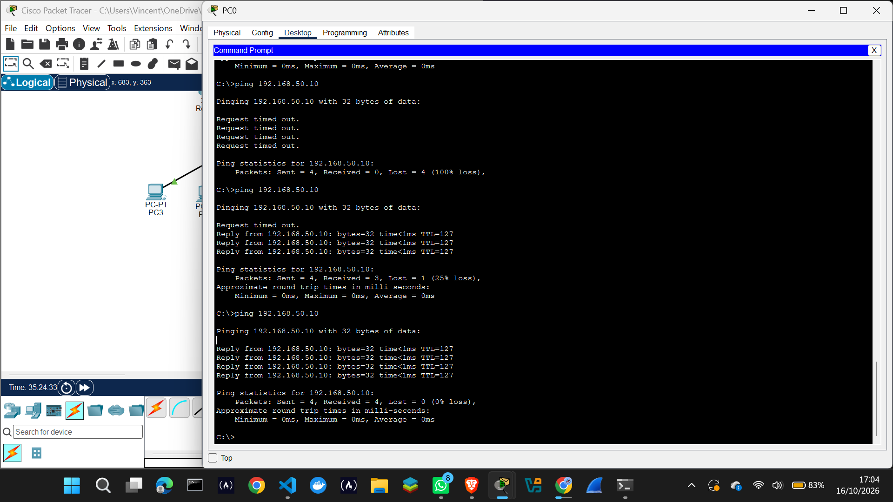

# Corporate Network Infrastructure — Cisco Packet Tracer

A practical computer networking project developed by **Kelvin Kiptoo Ngetich** using Cisco Packet Tracer. The project demonstrates small-business network design, VLAN segmentation, inter-VLAN routing, IP addressing, network services, secure device management, connectivity testing, and troubleshooting.

## 1. Project Overview

The goal of this project is to design and test a segmented business network that supports different departments while allowing authorized communication between networks.

The simulated environment represents a small business with separate networks for IT, Finance, HR, Reception, and Servers.

## 2. Network Design

The network uses a Cisco 2911 router and a Cisco 2960 switch.

Key design elements include:

- Five VLANs representing different departments and services.
- VLAN segmentation to separate departmental traffic.
- Router-on-a-stick configuration for inter-VLAN routing.
- IPv4 addressing and subnetting.
- DHCP configuration for client addressing.
- SSH-based switch management.
- A dedicated server network hosting simulated business services.

## 3. VLANs and IP Addressing

The network uses separate IPv4 subnets for the departmental VLANs and server network.

The IT workstation uses `192.168.10.11/24`, with `192.168.10.1` as its default gateway.

The server uses `192.168.50.10` on the `192.168.50.0/24` network.

These addresses are used in the documented connectivity and troubleshooting tests.

## 4. Network Services

The simulated server provides the following services:

- DNS
- HTTP
- Email
- FTP

These services represent common applications that may be used in a small-business network.

## 5. Security and Device Management

The project demonstrates basic network management and security practices, including:

- VLAN-based network segmentation.
- SSH-only remote switch management.
- Initial device configuration.
- Saved router configuration.
- Connectivity verification between network devices.
- Troubleshooting of gateway and management connectivity problems.

This is a learning simulation and is not a claim of a complete production security assessment.

## 6. Testing and Verification

The project includes practical connectivity and configuration checks.

Testing covered:

- Switch management connectivity from the IT workstation.
- Router configuration and saved settings.
- Communication between network devices.
- Connectivity to the server on a different subnet.
- Troubleshooting and verification after correcting a network configuration error.

The switch management ping initially timed out. After moving the management interface to VLAN 10, a subsequent test received four replies with zero packet loss.

## 7. Controlled Fault Diagnosis: Incorrect Default Gateway

### Problem

The IT workstation could not reach the server at `192.168.50.10` during a controlled troubleshooting test.

### Cause

The workstation's default gateway was temporarily changed from `192.168.10.1` to the incorrect address `192.168.10.254`.

### Diagnosis

The workstation could still ping `192.168.10.1` because the gateway was on the same subnet. However, communication with the server on the separate `192.168.50.0/24` network failed while the incorrect gateway was configured.

### Resolution

The workstation's default gateway was restored to `192.168.10.1`.

### Verification

A repeat ping to `192.168.50.10` received four replies with zero packet loss.

### Evidence

### Lesson Learned

A workstation may communicate with devices on its local subnet but fail to reach other networks when its default gateway is incorrect. Effective troubleshooting involves identifying the fault, correcting the configuration, and repeating the test to verify the resolution.

## 8. Project Files

- `Kelvin-Business-Solutions-VLAN.pkt` — Cisco Packet Tracer network simulation.
- Root directory — configuration and testing screenshots.
- `evidence/` — additional troubleshooting evidence, including `gateway-fault-and-repair.png`.
- `README.md` — project documentation.

## 9. Networking Skills Demonstrated

- IPv4 addressing and subnetting.
- VLAN configuration and segmentation.
- Inter-VLAN routing.
- Router and switch configuration.
- DHCP and server services.
- SSH-based device management.
- Connectivity testing and fault diagnosis.
- Technical documentation and evidence collection.

## 10. Learning Objectives

This project supports practical learning in network installation, configuration, verification, troubleshooting, and documentation. It can be used as a portfolio demonstration of foundational networking skills developed through hands-on work in Cisco Packet Tracer.

## 11. Author

**Kelvin Kiptoo Ngetich**

A practical computer networking project developed using Cisco Packet Tracer for learning and portfolio demonstration.